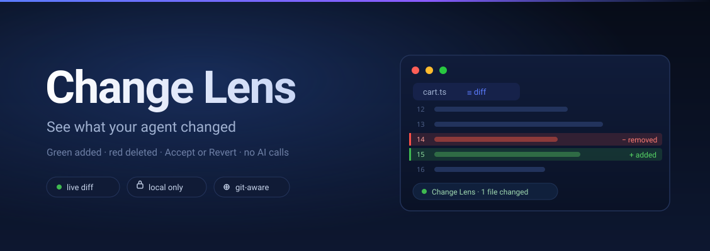
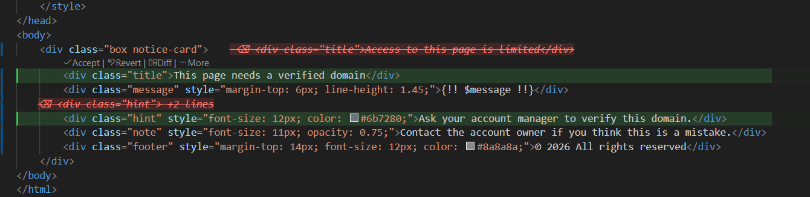

<div align="center">



<br>

**See what your agent changed, right in VS Code.** Added lines in green, deleted lines in red,
Accept and Revert buttons — all computed locally, without a single AI request.


</div>

## Why

Agents edit files faster than you can review them. A chat window says “done” and you are left staring at
a file, guessing what moved. `git diff` helps only after a commit, and only for tracked files.

Change Lens watches the files of your workspace and shows the difference the moment it appears:
green lines for additions, a red struck-through ghost for deletions, and two buttons — **Accept** or
**Revert**. No AI, no keys, no configuration: it compares a snapshot with what landed on disk.

<div align="center">
  
  <sub>A real change in VS Code: added lines are green, a deleted block shows up as a red struck-through ghost,
  and <b>Accept</b> / <b>Revert</b> / <b>Diff</b> sit right above the block.</sub>
</div>

Works with any tool that writes files — DeepSeek Harness, Claude Code, Cursor, Codex, scripts,
generators. Changes made by git are ignored automatically.

## Install

All you need is VS Code **1.90 or newer**. No Node.js, no npm, no DeepSeek account.

1. Download `change-lens-0.5.0.vsix` from [`dist/`](dist) or from Releases.
2. `Ctrl+Shift+P` → **Extensions: Install from VSIX…** → pick the file.
3. Reload the window: `Ctrl+Shift+P` → **Developer: Reload Window**.

That's it — `✦ Change Lens` shows up in the status bar.

<details>
<summary>Install from the terminal</summary>

```powershell
code --install-extension .\change-lens-0.5.0.vsix --force
```
</details>

## Usage

1. Open your project in VS Code **as a folder** (not a single file).
2. Work with your agent as usual — it edits files.
3. Changed lines are highlighted, and `⑂ Change Lens · N` appears in the status bar.

| Action | How |
| --- | --- |
| List of changed files | `Ctrl+Alt+Shift+D` or click `⑂ Change Lens` |
| Accept a change | `Ctrl+Alt+Enter` |
| Revert the file | `Ctrl+Alt+Backspace` |
| Full diff in a separate tab | **Diff** button above the block |
| Extension log | `Ctrl+Shift+P` → **Change Lens: Show Log** |

`✦ Change Lens` in the status bar is just an indicator: `✦` means no changes, `⑂` means there are some.

## How it works

1. On startup the extension snapshots the files of the workspace.
2. Any tool writes a file — VS Code reloads it from disk.
3. The extension reads the new content, diffs it against the snapshot and draws the result.
4. **Accept** forgets the change, **Revert** writes the old text back and saves, **Diff** opens a regular
   diff tab.

## Good to know

- **The snapshot is taken when VS Code starts.** Anything changed while the editor was closed has nothing
  to compare against. Open VS Code first, then work with the agent.
- **The file has to be open** for the highlight to appear immediately. Otherwise the change is counted in
  the status bar and highlighted once you open the file.
- **Real red lines are impossible** for third-party extensions — that is Copilot's private API. Deleted
  lines are therefore shown as a ghost, and the **Diff** button opens a normal diff tab.
- Skipped: `node_modules`, `vendor`, `storage`, `dist`, `build`, `.git` and similar folders, files larger
  than 512 KB, and binary files.
- **Git is ignored:** while git is touching its own directory (a sign of `pull`, `checkout`, `merge`,
  `rebase`, `stash`), changes are treated as external and not highlighted — the snapshot is just updated.
  Five seconds after `.git` goes quiet, highlighting works again.
- If you edit or save the file yourself, the change counts as accepted and the highlight is cleared.

## Development

Build, tests, project layout and publishing: [DEVELOPMENT.md](DEVELOPMENT.md).

## License

MIT — see [LICENSE](LICENSE).
